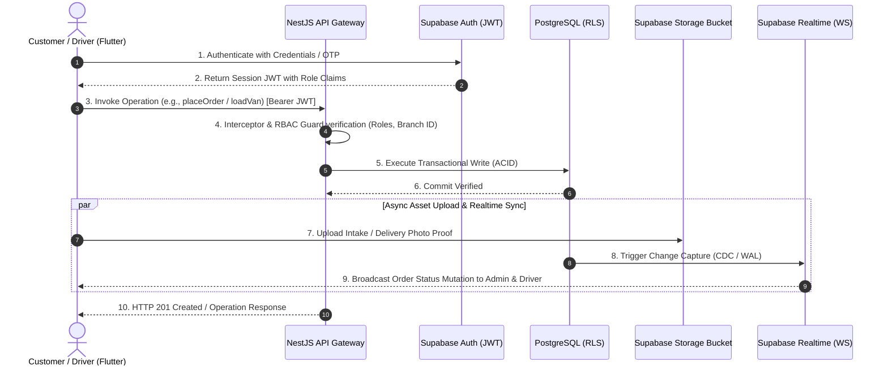

# UniWash Laundry Platform — Technical Architecture Specification

> **Target Audience:** Senior Software Engineers, DevOps/SREs, Solution Architects  
> **Status:** Production-Ready Architecture Blueprint  
> **Platform Version:** Enterprise v2.4 (Multi-Branch & Multi-Tenant GCC)

---

## 1. System Architecture Overview

| Layer | Technology | Key Responsibilities |
| :--- | :--- | :--- |
| **Client Frontend** | Flutter SDK (Mobile, Web, Desktop) | Cross-platform multi-role client (Customer App, Laundry Operations Terminal, Driver GPS App, Customer Service Console, Regional Admin & Super Admin Portal). |
| **Backend API Gateway & Services** | Node.js + NestJS (TypeScript) | Core business logic, order state machines, RBAC permission guard rails, branch fulfillment engines, audit logging, and external integrations (payment gateways, WhatsApp Business API). |
| **Relational Database** | PostgreSQL 15+ (via Supabase) | Persistent data store for identities, branch hierarchies, order itemizations, thermal label mappings, wallet ledgers, and audit logs with ACID compliance. |
| **Data Isolation & Security** | PostgreSQL Row-Level Security (RLS) | Database-level tenant and branch isolation ensuring laundry workers, drivers, and branches only access records in their authorized scope. |
| **Identity & Access Management (IAM)** | Supabase Auth (OAuth 2.0 / JWT) | Cryptographically signed JSON Web Tokens (RS256), session rotation, passwordless OTPs for drivers, and role claims. |
| **Object & Document Storage** | Supabase Storage (S3-Compatible) | Scalable object storage buckets for proof-of-delivery photos, vehicle inspection records, garment condition intake photos, and thermal label assets. |
| **Real-Time Event Stream** | Supabase Realtime / WebSockets | Low-latency bi-directional state synchronization for live order dispatch, driver telemetry GPS coordinates, and push alerts. |

---

## 2. Component Interaction & Data Flow



---

## 3. Component Deep Dive

### 3.1 Backend Service (Node.js + NestJS)

The NestJS backend application enforces a domain-driven modular structure:

```
src/
├── app.module.ts
├── common/
│   ├── decorators/           # @Roles(), @CurrentBranch(), @CurrentUser()
│   ├── filters/              # GlobalExceptionFilter, RlsViolationFilter
│   ├── guards/               # JwtAuthGuard, RolesGuard, BranchAccessGuard
│   ├── interceptors/         # AuditLogInterceptor, TransformResponseInterceptor
│   └── pipes/                # ValidationPipe, ParseObjectIdPipe
└── modules/
    ├── auth/                 # Supabase JWT validation & session lifecycles
    ├── orders/               # Order lifecycle state machine, validation & billing
    ├── branches/             # Country & Branch multi-tenant hierarchy
    ├── drivers/              # Fleet management, inspection checklist & telemetry
    ├── laundry/              # Garment inspection, washing cycles & bulk QR labels
    ├── wallet/               # Double-entry ledger, cashback promotions & top-ups
    ├── audit/                # Immutable change logs for admin corrections
    └── diagnostics/          # Engineer portal bug tracking & system health checks
```

#### Key Architectural Guardrails:
* **Strict Price Masking Guardrail:** Orders and items endpoints filter out monetary amounts when queried by `laundryWorker`, `driver`, `customerService`, or `engineer`. Pricing fields are strictly exposed only to `customer`, `regionalAdmin`, and `superAdmin`.
* **State Machine Invariants:** Order statuses follow a strict, non-skippable progression:
  $$\text{Draft} \longrightarrow \text{Pending} \longrightarrow \text{DriverAssigned} \longrightarrow \text{PickedUp} \longrightarrow \text{InLaundry} \longrightarrow \text{ReadyForDelivery} \longrightarrow \text{OutForDelivery} \longrightarrow \text{Delivered}$$

---

### 3.2 Relational Database Layer (PostgreSQL / Supabase)

#### Core Relational Schema

```sql
-- 1. Multi-Tenant Branch Hierarchy
CREATE TABLE branches (
    id UUID PRIMARY KEY DEFAULT gen_random_uuid(),
    country_code VARCHAR(3) NOT NULL, -- 'QAT', 'KSA', 'UAE'
    branch_code VARCHAR(20) UNIQUE NOT NULL, -- e.g. 'LND-DOHA-01'
    name VARCHAR(100) NOT NULL,
    is_active BOOLEAN DEFAULT TRUE,
    created_at TIMESTAMPTZ DEFAULT NOW()
);

-- 2. Extended Profiles & RBAC
CREATE TABLE profiles (
    id UUID PRIMARY KEY REFERENCES auth.users(id) ON DELETE CASCADE,
    branch_id UUID REFERENCES branches(id),
    role VARCHAR(30) NOT NULL CHECK (role IN ('customer', 'driver', 'laundryWorker', 'customerService', 'engineer', 'regionalAdmin', 'superAdmin')),
    full_name VARCHAR(100) NOT NULL,
    phone VARCHAR(30) NOT NULL,
    wallet_balance NUMERIC(12, 2) DEFAULT 0.00 CHECK (wallet_balance >= 0.00),
    loyalty_points INT DEFAULT 0,
    created_at TIMESTAMPTZ DEFAULT NOW()
);

-- 3. Orders Master Table
CREATE TABLE orders (
    id UUID PRIMARY KEY DEFAULT gen_random_uuid(),
    order_number VARCHAR(20) UNIQUE NOT NULL,
    branch_id UUID NOT NULL REFERENCES branches(id),
    customer_id UUID NOT NULL REFERENCES profiles(id),
    assigned_driver_id UUID REFERENCES profiles(id),
    status VARCHAR(30) NOT NULL,
    payment_method VARCHAR(20) NOT NULL,
    subtotal NUMERIC(10, 2) NOT NULL,
    discount_amount NUMERIC(10, 2) DEFAULT 0.00,
    delivery_fee NUMERIC(10, 2) DEFAULT 15.00,
    total_amount NUMERIC(10, 2) NOT NULL,
    special_instructions TEXT,
    qr_code_payload VARCHAR(100) NOT NULL,
    created_at TIMESTAMPTZ DEFAULT NOW(),
    updated_at TIMESTAMPTZ DEFAULT NOW()
);

-- 4. Order Line Items
CREATE TABLE order_items (
    id UUID PRIMARY KEY DEFAULT gen_random_uuid(),
    order_id UUID NOT NULL REFERENCES orders(id) ON DELETE CASCADE,
    catalog_item_id VARCHAR(50) NOT NULL,
    item_name VARCHAR(100) NOT NULL,
    service_type VARCHAR(30) NOT NULL,
    unit_price NUMERIC(10, 2) NOT NULL,
    quantity_or_weight NUMERIC(8, 2) NOT NULL,
    effective_total NUMERIC(10, 2) NOT NULL,
    notes TEXT
);

-- 5. Wallet Ledger (Double-Entry Audit)
CREATE TABLE wallet_transactions (
    id UUID PRIMARY KEY DEFAULT gen_random_uuid(),
    profile_id UUID NOT NULL REFERENCES profiles(id),
    title VARCHAR(150) NOT NULL,
    amount NUMERIC(10, 2) NOT NULL,
    is_credit BOOLEAN NOT NULL,
    reference VARCHAR(50),
    transaction_type VARCHAR(30) NOT NULL, -- 'top_up', 'bonus', 'order_payment', 'refund'
    created_at TIMESTAMPTZ DEFAULT NOW()
);
```

#### Row-Level Security (RLS) Policies

```sql
ALTER TABLE orders ENABLE ROW LEVEL SECURITY;

-- Customers can only view their own orders
CREATE POLICY customer_orders_policy ON orders
    FOR SELECT TO authenticated
    USING (
        auth.uid() = customer_id 
        OR (auth.jwt() ->> 'role') IN ('superAdmin', 'regionalAdmin')
    );

-- Drivers can only view orders assigned to them or ready for pickup in their branch
CREATE POLICY driver_orders_policy ON orders
    FOR SELECT TO authenticated
    USING (
        ((auth.jwt() ->> 'role') = 'driver' AND (assigned_driver_id = auth.uid() OR status = 'readyForDelivery'))
        OR (auth.jwt() ->> 'role') IN ('superAdmin', 'regionalAdmin')
    );
```

---

### 3.3 Identity & Access Management (Supabase Auth)

* **Stateless Token Verification:** Each request contains an `Authorization: Bearer <JWT>` header containing user identity and custom claims:
  ```json
  {
    "sub": "b20a2848-0dc0-426d-add7-a06fa437cbef",
    "role": "customer",
    "branch_id": "89e5a1b3-4f12-42da-992a-3bb1cf92da11",
    "country_code": "QAT",
    "iat": 1728556800,
    "exp": 1728560400
  }
  ```
* **Guard Rails:** NestJS custom `RolesGuard` decorates route handlers with allowed roles:
  ```typescript
  @UseGuards(JwtAuthGuard, RolesGuard)
  @Roles('superAdmin', 'regionalAdmin')
  @Get('audit-logs')
  getSystemAuditLogs(@CurrentBranch() branchId: string) { ... }
  ```

---

### 3.4 Storage Subsystem (Supabase Storage)

* **Buckets Structure:**
  - `delivery-proofs/`: Driver intake & dropoff proof-of-delivery photos (JPEG/WebP, max 5MB).
  - `duty-checklists/`: Van inspections (5 mandatory checklist images before shift).
  - `thermal-assets/`: Thermal printer label preview cache (ZPL/ESC-POS rendering).
* **Storage Access Rules:** Buckets are protected via signed URLs with time-limited expirations (60 minutes) for sensitive customer delivery proof photos.

---

### 3.5 Real-Time Communication (Supabase Realtime)

* **Order Dispatch & Fulfillment Pipeline:**
  - Channel: `orders:branch_{branchId}`
  - Events: `ORDER_CREATED`, `DRIVER_ASSIGNED`, `STATUS_CHANGED`, `LAUNDRY_INTAKE`
* **Driver High-Frequency GPS Tracking:**
  - Channel: `driver_telemetry:{orderId}`
  - Ephemeral Presence: Transmits `{ lat, lng, heading, speed, timestamp }` every 3 seconds to listening customer and dispatcher screens without writing every tick to disk.

---

## 4. Flutter Client Integration Architecture

```
lib/
├── models/             # Immutable data models with JSON serialization
├── services/           # StateService, LocalizationService, SupabaseClient
├── theme/              # Material 3 executive theme, design tokens
├── utils/              # QR generator, DriverNavigationHelper, thermal spools
└── screens/
    ├── customer/       # Customer catalog, cart, digital pass, tracking
    ├── driver/         # Duty checklist, GPS navigation, WhatsApp triggers
    ├── laundry/        # Batch QR printer studio, thermal spooling, analytics
    ├── customer_service/# Manual ticket override, complaint manager
    ├── engineer/       # Diagnostic telemetry, system bug logs
    ├── admin/          # Branch dispatching, driver assignment
    └── super_admin/    # Multi-country governance, RBAC matrix, audit trail
```

---

## 5. Deployment & Production Scalability

* **Containerization:** NestJS application packaged via multi-stage Docker container deployed to cloud containers (AWS ECS / GCP Cloud Run / Fly.io).
* **Connection Pooling:** PostgreSQL database utilizes Supavisor / PgBouncer for transaction connection pooling (up to 10,000 concurrent client connections).
* **Horizontal Scaling:** Stateless API tier scales horizontally based on CPU and request latency thresholds.
